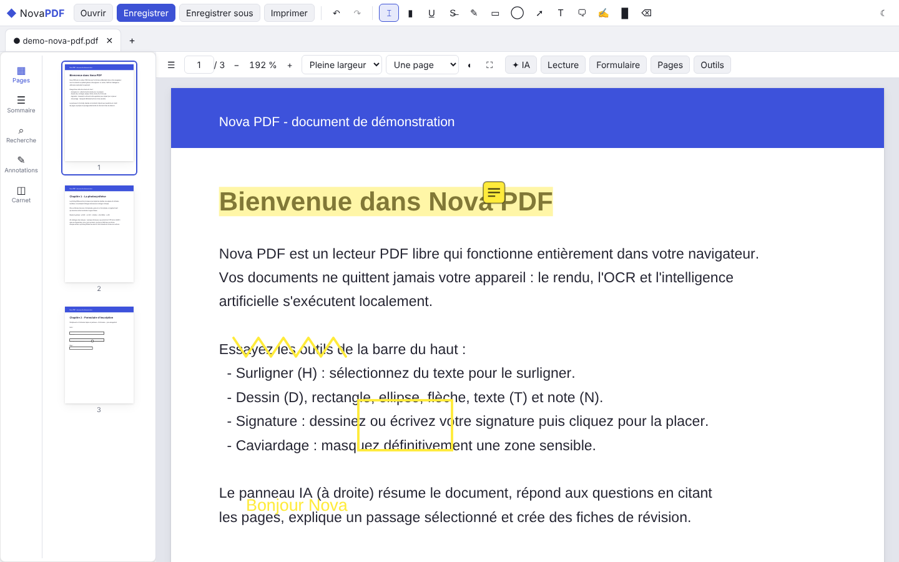

# ◆ Nova PDF

**Le lecteur PDF libre, rapide et privé, avec une IA qui tourne sur votre appareil.**

Nova PDF fait dans le navigateur ce que font les lecteurs PDF du marché (lire, annoter, signer, remplir, organiser, convertir, OCR) et ajoute ce qu'on attend des lecteurs de demain : un assistant IA **100 % local** qui résume, répond en citant les pages, explique, traduit et crée des fiches de révision. Aucun document ne quitte votre machine.



> Web app installable (PWA) · React + TypeScript · pdf.js · pdf-lib · Tesseract · WebLLM / Ollama · Licence MIT

---

## Fonctionnalités

### Lire
- Rendu haute fidélité (pdf.js), chargement paresseux des pages, documents volumineux
- Onglets multi-documents, glisser-déposer, « Ouvrir avec » une fois l'app installée
- Miniatures, sommaire (signets), recherche plein texte avec extraits et surlignage
- Zoom libre, pleine largeur, page entière, affichage une ou deux pages
- Mode nuit (inversion des pages), thème sombre, mode concentration (`F`)
- Liens internes et externes cliquables, **aperçu de la page cible au survol d'un lien**
- **Mode lecture** : texte remis en forme (reflow), taille et police réglables
- **Lecture à voix haute** (synthèse vocale du système) avec suivi de page
- **Reprise automatique** à la dernière page lue
- PDF protégés par mot de passe

### Annoter
- Surligner, souligner, barrer (à partir de la sélection de texte)
- Dessin libre, rectangle, ellipse, flèche, zone de texte, note (vraie annotation PDF lisible dans Acrobat, etc.)
- Couleurs, épaisseur, taille du texte ; gomme ; annuler / rétablir
- Liste des annotations du document
- **Carnet** : tous vos surlignages et notes, *tous documents confondus*, mémorisés localement (IndexedDB)

### Remplir et signer
- Formulaires interactifs (texte, cases, listes, boutons radio), option « figer »
- Signature dessinée, écrite (manuscrite) ou importée, mémorisée sur l'appareil
- Texte libre n'importe où pour les formulaires « papier »

### Organiser
- Réordonner par glisser-déposer, pivoter, dupliquer, supprimer, inverser
- Insérer des pages blanches, extraire une sélection
- Fusionner plusieurs PDF, découper par plages ou page par page

### Transformer et protéger
- Filigrane, numérotation des pages
- **OCR local** (Tesseract, 8 langues) : ajoute une couche de texte invisible, le scan devient cherchable et copiable
- **Caviardage réel** : la page caviardée est rastérisée, le texte masqué disparaît du fichier
- Propriétés du document (titre, auteur…) et suppression des métadonnées
- Export PNG / JPG / texte / Markdown, création d'un PDF à partir d'images
- **Comparaison de deux versions** (différences ligne à ligne)
- Optimisation de la taille, impression

### IA locale
| Action | Description |
|---|---|
| Résumer le document | Synthèse structurée ; *map-reduce* automatique pour les longs documents |
| Questions / réponses | Recherche BM25 dans le document, réponse **avec pages citées cliquables** |
| Expliquer la sélection | Vulgarise un passage, définit les termes |
| Traduire la page | 8 langues |
| Fiches de révision | À partir de vos surlignages (ou de la page courante) |
| Extraire les données | Chiffres, dates, noms et définitions en tableau |

Deux moteurs, tous deux locaux :
- **WebLLM** : le modèle s'exécute *dans le navigateur* via WebGPU (Chrome / Edge récents). Modèles proposés : Qwen 2.5 (1,5B, 3B, 7B), Llama 3.2 3B, Phi-4 mini. Téléchargé une fois, puis mis en cache.
- **Ollama** : utilise les modèles installés sur votre ordinateur.

---

## Démarrer

```bash
git clone https://github.com/Geld237/nova-pdf.git
cd nova-pdf
npm install
npm run dev        # http://localhost:5173
```

Production :

```bash
npm run build      # génère dist/
npm run preview
```

Le dépôt contient un workflow GitHub Actions qui publie automatiquement l'app sur **GitHub Pages** à chaque push sur `main` (Settings → Pages → Source : *GitHub Actions*).

### Utiliser Ollama

```bash
# autoriser l'app web à appeler Ollama
OLLAMA_ORIGINS="*" ollama serve
ollama pull llama3.2       # ou qwen2.5, mistral, gemma3…
```
Puis, dans Nova PDF : panneau **✦ IA** → ⚙ → Moteur « Ollama ».

---

## Raccourcis clavier

| Touche | Action | Touche | Action |
|---|---|---|---|
| `Ctrl+O` | Ouvrir | `V` | Sélection |
| `Ctrl+S` / `Ctrl+Maj+S` | Enregistrer / sous | `H` `U` `S` | Surligner / souligner / barrer |
| `Ctrl+P` | Imprimer | `D` | Dessin libre |
| `Ctrl+F` | Rechercher | `R` `E` `A` | Rectangle / ellipse / flèche |
| `Ctrl+Z` / `Ctrl+Y` | Annuler / rétablir | `T` `N` | Texte / note |
| `Ctrl +` / `Ctrl -` / `Ctrl 0` | Zoom / pleine largeur | `X` | Gomme |
| `←` `→` `Début` `Fin` | Navigation | `F` / `Échap` | Concentration / quitter |

---

## Architecture

```
src/
├── App.tsx                 # coquille : onglets, barres, raccourcis, enregistrement
├── pdf/
│   ├── engine.ts           # pdf.js : ouverture, texte, sommaire, rendu
│   ├── writer.ts           # pdf-lib : écriture des annotations, caviardage
│   ├── tools.ts            # pages, fusion, découpe, filigrane, export, diff…
│   ├── forms.ts            # lecture / écriture des champs de formulaire
│   └── ocr.ts              # Tesseract + couche de texte invisible
├── ai/
│   ├── llm.ts              # moteurs WebLLM et Ollama (streaming)
│   └── retrieval.ts        # découpage + index BM25 (RAG hors ligne)
├── components/             # Viewer, PageView, Sidebar, panneaux, signature
└── memory.ts               # mémoire locale (IndexedDB) : annotations, signatures
```

Les annotations sont stockées dans un modèle indépendant (coordonnées du viewport à l'échelle 1), affichées en SVG au-dessus de la page, et n'écrites dans le PDF qu'à l'enregistrement. Le fichier d'origine n'est jamais modifié tant que vous n'enregistrez pas.

## Confidentialité

- Aucun serveur : tout le traitement se fait dans votre navigateur.
- L'IA tourne localement (WebGPU ou Ollama sur `localhost`).
- Seuls téléchargements réseau : les poids du modèle IA et les données de langue OCR, une seule fois, depuis leurs CDN publics.

## Feuille de route

Voir [ROADMAP.md](ROADMAP.md) pour les fonctions prévues (signature certifiée, chiffrement, recherche sémantique, vision, collaboration P2P, app desktop Tauri…).

## Contribuer

Les contributions sont les bienvenues : voir [CONTRIBUTING.md](CONTRIBUTING.md).

## Licence

[MIT](LICENSE). Nova PDF s'appuie sur [pdf.js](https://github.com/mozilla/pdf.js) (Apache-2.0), [pdf-lib](https://github.com/Hopding/pdf-lib) (MIT), [Tesseract.js](https://github.com/naptha/tesseract.js) (Apache-2.0) et [WebLLM](https://github.com/mlc-ai/web-llm) (Apache-2.0).
