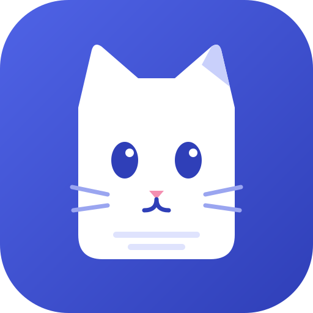
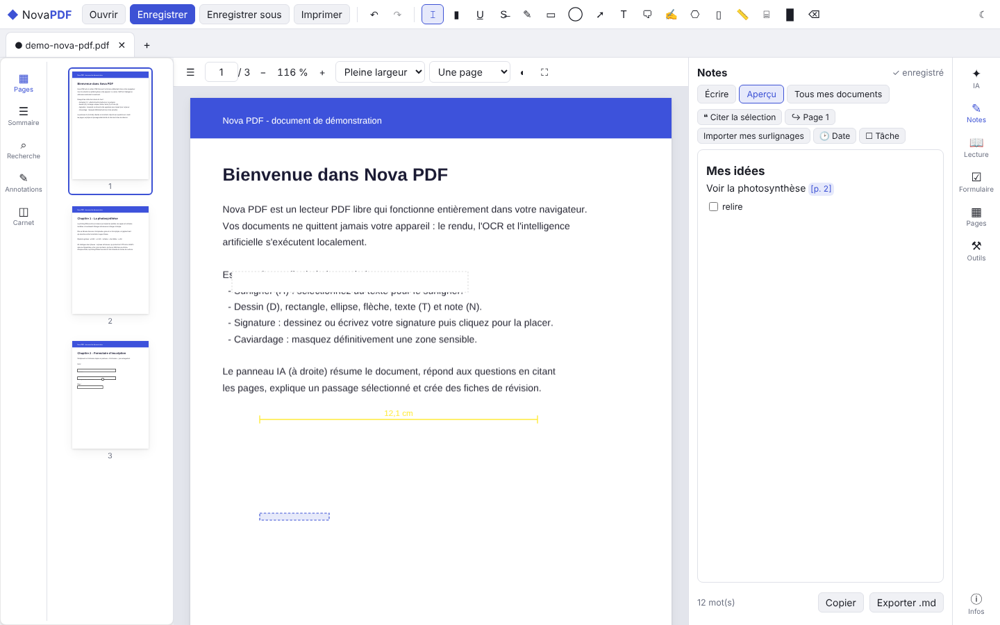
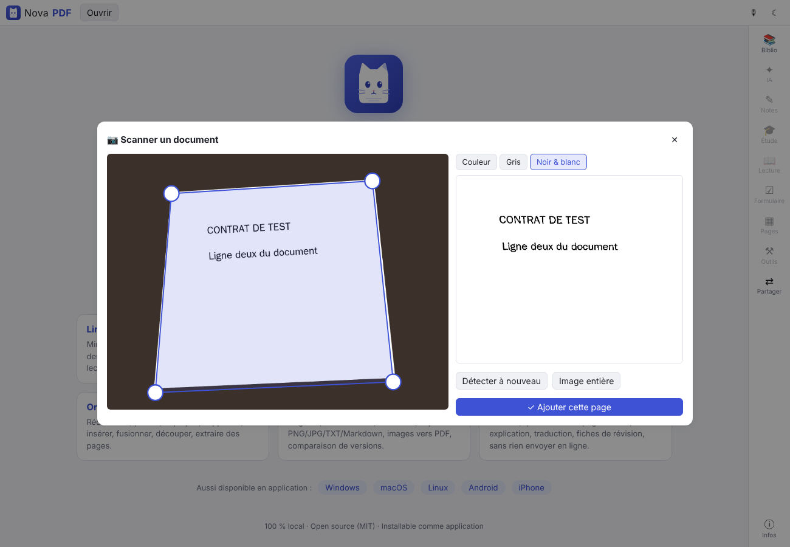
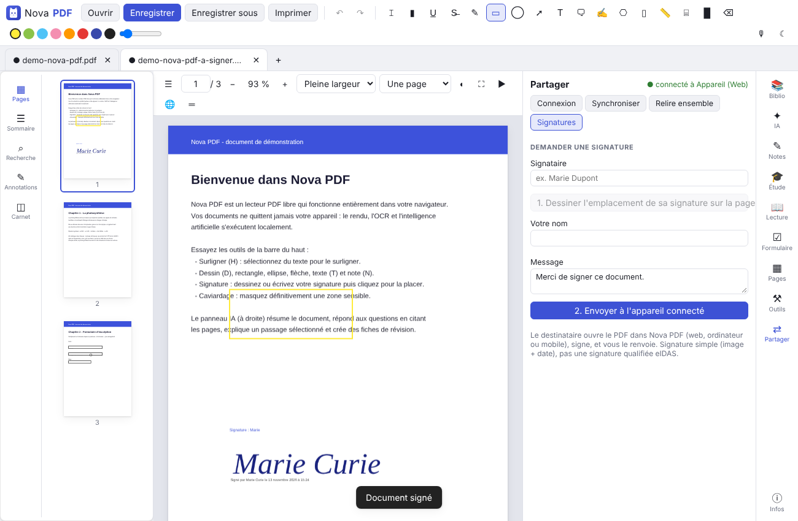

<p align="center"></p>

# Nova PDF

**Le lecteur PDF libre, rapide et privé, avec une IA qui tourne sur votre appareil.**

Nova PDF fait dans le navigateur ce que font les lecteurs PDF du marché (lire, annoter, signer, remplir, organiser, convertir, OCR) et ajoute ce qu'on attend des lecteurs de demain : un assistant IA **100 % local** qui résume, répond en citant les pages, explique, traduit et crée des fiches de révision. Aucun document ne quitte votre machine.


| Notes | Scanner | Signature à distance |
|---|---|---|
|  |  |  |

> Web app installable (PWA) · React + TypeScript · pdf.js · pdf-lib · Tesseract · WebLLM / Ollama · Licence MIT

---

## Fonctionnalités

### Lire
- Rendu haute fidélité (pdf.js), chargement paresseux des pages, documents volumineux
- Onglets multi-documents, glisser-déposer, « Ouvrir avec » une fois l'app installée
- Miniatures, sommaire (signets), recherche plein texte avec extraits et surlignage
- Zoom libre, pleine largeur, page entière, affichage une ou deux pages
- Mode nuit (inversion des pages), thème sombre, mode concentration (`F`)
- Liens internes et externes cliquables, **aperçu de la page cible au survol d'un lien**
- **Mode lecture** : texte remis en forme (reflow), taille et police réglables
- **Lecture à voix haute** (synthèse vocale du système) avec suivi de page
- **Reprise automatique** à la dernière page lue
- PDF protégés par mot de passe

### Annoter
- Surligner, souligner, barrer (à partir de la sélection de texte)
- Dessin libre, rectangle, ellipse, flèche, zone de texte, note (vraie annotation PDF lisible dans Acrobat, etc.)
- Couleurs, épaisseur, taille du texte ; gomme ; annuler / rétablir
- Liste des annotations du document
- **Carnet** : tous vos surlignages et notes, *tous documents confondus*, mémorisés localement (IndexedDB)

### Prendre des notes (panneau de droite)
- Un carnet de notes par document, enregistré automatiquement sur l'appareil
- **Citer la sélection** (avec sa page), insérer un renvoi `[p. 12]` cliquable, date, cases à cocher
- Importer tous ses surlignages d'un clic ; l'assistant IA peut **ajouter ses réponses aux notes**
- Aperçu Markdown, vue « tous mes documents », export `.md`

### Remplir et signer
- Formulaires interactifs (texte, cases, listes, boutons radio), option « figer »
- Signature dessinée, écrite (manuscrite) ou importée, mémorisée sur l'appareil
- Texte libre n'importe où pour les formulaires « papier »
- **Créer un formulaire** : dessiner des champs texte et des cases à cocher
- **Tampons** (Approuvé, Payé, Confidentiel… ou personnalisé, avec la date)

### Organiser
- Réordonner par glisser-déposer, pivoter, dupliquer, supprimer, inverser
- Insérer des pages blanches, extraire une sélection
- Fusionner plusieurs PDF, découper par plages ou page par page

### Transformer et protéger
- **Protéger par mot de passe** (AES-256, permissions d'impression, copie, modification…) et **déverrouiller**
- Ouverture des PDF protégés : le document est déchiffré pour la session, tous les outils fonctionnent
- **Compression** sans perte ou forte (pages en JPEG, 72–150 dpi), **réparation** de fichiers abîmés
- **Recadrer**, **plusieurs pages par feuille** (2, 4, 6, 9), **changer le format** (A3, A4, A5, Letter, Legal)
- **Signets** (créer, renommer, réordonner), **pièces jointes**, **préférences d'affichage**, **aplatir**
- **Correcteur blanc** pour masquer puis réécrire, **mesure** de distances à l'échelle (plans 1:N)
- Conversion en **Word (.docx)** et **HTML**, extraction des images, PDF vierge, texte → PDF, scan par caméra
- Filigrane, numérotation des pages
- **OCR local** (Tesseract, 8 langues) : ajoute une couche de texte invisible, le scan devient cherchable et copiable
- **Caviardage réel** : la page caviardée est rastérisée, le texte masqué disparaît du fichier
- Propriétés du document (titre, auteur…) et suppression des métadonnées
- Export PNG / JPG / texte / Markdown, création d'un PDF à partir d'images
- **Comparaison de deux versions** (différences ligne à ligne)
- Optimisation de la taille, impression

### Bibliothèque
- Tous les PDF ouverts sont rangés automatiquement (désactivable) : **dossiers**, **étiquettes**, **favoris**, documents récents sur l'accueil
- **Recherche plein texte dans tous vos PDF**, avec extraits et ouverture à la bonne page

### IA sur plusieurs documents
- Questions sur **les onglets ouverts ou toute la bibliothèque**, réponses citées `[D2, p. 4]` (clic = ouvre le bon document à la bonne page)
- **Comparer des contrats** (parties, durée, prix, résiliation, responsabilité…) et **revue de littérature** (objectif, méthode, résultats, limites) en tableau

### Étude
- **Fiches de révision à répétition espacée** (algorithme SM-2) : créées par l'IA à partir de vos surlignages, d'une page ou du document, ou à la main
- **Quiz** : QCM générés par l'IA, ou QCM hors ligne construits à partir de vos fiches ; rappel des fiches à réviser sur l'accueil

### Confidentialité
- **Anonymisation automatique** : e-mails, téléphones, IBAN (clé vérifiée), cartes bancaires (Luhn), n° de sécurité sociale, SIREN/SIRET, adresses, dates, noms (règles + IA locale facultative) → caviardage réel
- **Profil de remplissage** (Infos → Profil) : « ✨ Remplir avec mon profil » complète les formulaires (nom, adresse, e-mail…)

### Lecture augmentée
- **Traduction côte à côte** de tout le document (page originale | traduction), export Word / PDF
- **Podcast** : l'IA écrit un dialogue à deux voix (Léa et Max) lu par la synthèse vocale
- **Mode présentation** : plein écran, **pointeur laser**, dessin éphémère, écran noir/blanc, chronomètre
- **Police OpenDyslexic** et **règle de lecture** (masque au-dessus et au-dessous de la ligne)
- **Recherche universitaire** : extraction de la bibliographie et des DOI, export **BibTeX** et **RIS** (Zotero, Mendeley, EndNote), notices Crossref (facultatif, en ligne), **aperçu d'une référence au survol** d'un appel `[12]`

### Mobile et voix
- **Scanner** : détection automatique des bords, coins ajustables, **redressement de perspective**, filtres couleur / gris / noir et blanc, plusieurs pages → PDF
- **Commandes vocales** (🎙) : « page suivante », « page 12 », « cherche photosynthèse », « zoom avant », « note : relire le chapitre »… et **dictée** dans les notes
- **Raccourcis d'application** (appui long sur l'icône) : Scanner, Bibliothèque, Réviser

### Partage sans serveur ni compte
- **Connexion directe entre deux appareils** par QR code (WebRTC chiffré, pair-à-pair)
- **Synchronisation** de la bibliothèque, des annotations, notes et fiches
- **Relecture à plusieurs en direct** : les annotations apparaissent chez l'autre en temps réel, avec messagerie
- **Demande de signature** : placez les cadres de signature, envoyez (appareil connecté, partage, e-mail), le destinataire signe dans Nova PDF et renvoie

### Infos, paramètres et mises à jour (bouton ⓘ en bas à droite)
- **Document** : taille, version PDF, auteur, dates, format de la page, protection, pièces jointes
- **Paramètres** : thème, zoom par défaut, couleur de surlignage, langue OCR, reprise de lecture, mémoire des annotations
- **Mises à jour** : version et révision installées, *Rechercher une mise à jour*, comparaison avec la dernière version publiée sur GitHub, installation en un clic (et badge ↻ dans la barre quand une version est prête)
- **Données** : espace utilisé, sauvegarde / restauration de toutes vos annotations, notes et signatures, effacement
- Installation de l'application, raccourcis clavier, à propos

### IA locale
| Action | Description |
|---|---|
| Résumer le document | Synthèse structurée ; *map-reduce* automatique pour les longs documents |
| Questions / réponses | Recherche BM25 dans le document, réponse **avec pages citées cliquables** |
| Expliquer la sélection | Vulgarise un passage, définit les termes |
| Traduire la page | 8 langues |
| Fiches de révision | À partir de vos surlignages (ou de la page courante) |
| Extraire les données | Chiffres, dates, noms et définitions en tableau |

Deux moteurs, tous deux locaux :
- **WebLLM** : le modèle s'exécute *dans le navigateur* via WebGPU (Chrome / Edge récents). Modèles proposés : Qwen 2.5 (1,5B, 3B, 7B), Llama 3.2 3B, Phi-4 mini. Téléchargé une fois, puis mis en cache.
- **Ollama** : utilise les modèles installés sur votre ordinateur.

---

## Couverture des outils du marché

Comparaison avec les outils d'Adobe Acrobat et de PDF24. ✅ disponible · 🟡 partiel · 🔜 prévu ([ROADMAP](ROADMAP.md))

| Outil | Nova PDF | Outil | Nova PDF |
|---|---|---|---|
| Exporter / convertir le PDF | ✅ Word, HTML, PNG, JPG, TXT, MD | Fusionner | ✅ |
| Modifier un PDF | 🟡 correcteur blanc + texte, filigrane, numéros | Compresser / optimiser web | ✅ / 🟡 (linéarisation 🔜) |
| Créer un PDF | ✅ images, caméra, vierge, texte · 🔜 Office | Protéger / déverrouiller | ✅ AES-256 |
| Combiner, organiser, trier, pivoter, supprimer, extraire | ✅ | Découper | ✅ |
| Assistant IA, résumé génératif | ✅ 100 % local | PDF en images | ✅ |
| Demander des signatures électroniques | 🔜 (sans serveur, P2P) | Extraire les images | 🟡 JPEG |
| Scan et OCR | ✅ | Filigrane, numéros de page | ✅ |
| Biffer (caviarder) | ✅ suppression réelle | Signer, annoter | ✅ |
| Ajouter un tampon | ✅ | Recadrer | ✅ |
| Utiliser un certificat | 🔜 PAdES | Aplatir | ✅ |
| Prépresse | 🔜 | Métadonnées (modifier / supprimer) | ✅ |
| Mesurer des objets | ✅ distances à l'échelle · 🔜 surfaces | Préférences d'affichage | ✅ |
| Comparer des fichiers | ✅ texte | Plusieurs pages par feuille | ✅ |
| Contenu multimédia | 🟡 pièces jointes | Changer le format des pages | ✅ |
| Envoyer pour commentaires | 🔜 collaboration P2P | Réparer | ✅ |
| Actions guidées (lots) | 🔜 | Signets | ✅ |
| Préparer l'accessibilité, normes PDF/A | 🔜 | Créer un formulaire à remplir | ✅ |
| Index de recherche | 🟡 index local du document | JavaScript | non prévu (sécurité) |

---

## Installer

Toutes les versions sont sur la page **[Releases](https://github.com/Geld237/nova-pdf/releases/latest)**, compilées automatiquement par GitHub Actions.

| Plateforme | Fichier | Installation |
|---|---|---|
| **Windows** 10/11 | `Nova PDF_x.y.z_x64-setup.exe` (ou `.msi`) | Double-clic. Au premier lancement, SmartScreen peut afficher « Informations complémentaires → Exécuter quand même » (app non signée). |
| **macOS** 11+ (Apple Silicon et Intel) | `Nova PDF_x.y.z_universal.dmg` | Glisser dans Applications. App non signée : clic droit → **Ouvrir** la première fois (ou Réglages → Confidentialité et sécurité → « Ouvrir quand même »). |
| **Linux** | `.AppImage`, `.deb`, `.rpm` | `chmod +x *.AppImage && ./Nova*.AppImage`, ou `sudo apt install ./nova-pdf_*.deb` |
| **Android** 7+ | `Nova-PDF-x.y.z-android.apk` | Ouvrir le fichier sur le téléphone, autoriser « installer des applis inconnues ». |
| **iPhone / iPad** | Version web, ou `Nova-PDF-x.y.z-ios-unsigned.ipa` | Le plus simple : ouvrir l'app web dans Safari → Partager → **Sur l'écran d'accueil**. L'`.ipa` doit être signé (AltStore, Sideloadly avec un identifiant Apple gratuit, ou compte développeur pour TestFlight/App Store). |
| **Navigateur** | — | https://geld237.github.io/nova-pdf/ (installable en un clic dans Chrome/Edge) |

Toutes les versions partagent le même code : l'application de bureau utilise [Tauri](https://tauri.app) (≈ 5 Mo, WebView du système), les applications mobiles [Capacitor](https://capacitorjs.com). Sur ordinateur, les `.pdf` peuvent être associés à Nova PDF (double-clic, « Ouvrir avec ») ; sur Android et iOS, Nova PDF apparaît dans « Ouvrir avec / Partager ».

### Publier une nouvelle version

```bash
npm version 0.4.0 --no-git-tag-version   # change la version (déclenche la publication)
node scripts/sync-version.mjs            # la recopie dans Android, iOS et Tauri
git commit -am "v0.4.0" && git push
```
Le workflow **Publier les applications** crée la version GitHub et y ajoute tous les installeurs (≈ 20 min). Les applications installées le signalent dans **ⓘ Infos → Mises à jour**.

**Signatures facultatives** (secrets du dépôt, *Settings → Secrets → Actions*) :
- Android (Play Store) : `ANDROID_KEYSTORE_BASE64`, `ANDROID_KEYSTORE_PASSWORD`, `ANDROID_KEY_ALIAS`, `ANDROID_KEY_PASSWORD` → APK signé + `.aab`
- macOS : `APPLE_CERTIFICATE`, `APPLE_CERTIFICATE_PASSWORD`, `APPLE_SIGNING_IDENTITY`, `APPLE_ID`, `APPLE_PASSWORD`, `APPLE_TEAM_ID` → app signée et notarisée
- iOS App Store / TestFlight : nécessite un compte Apple Developer (99 $/an)

### Compiler soi-même

```bash
npm run desktop:dev        # app de bureau en développement (Rust requis)
npm run desktop:build      # installeur pour le système courant
npm run android:apk        # APK de débogage (Android Studio / SDK requis)
npm run ios:open           # ouvre le projet dans Xcode (macOS requis)
```

---

## Démarrer

```bash
git clone https://github.com/Geld237/nova-pdf.git
cd nova-pdf
npm install
npm run dev        # http://localhost:5173
```

Production :

```bash
npm run build      # génère dist/
npm run preview
```

Le dépôt contient un workflow GitHub Actions qui publie automatiquement l'app sur **GitHub Pages** à chaque push sur `main` (Settings → Pages → Source : *GitHub Actions*).

### Utiliser Ollama

```bash
# autoriser l'app web à appeler Ollama
OLLAMA_ORIGINS="*" ollama serve
ollama pull llama3.2       # ou qwen2.5, mistral, gemma3…
```
Puis, dans Nova PDF : panneau **✦ IA** → ⚙ → Moteur « Ollama ».

---

## Raccourcis clavier

| Touche | Action | Touche | Action |
|---|---|---|---|
| `Ctrl+O` | Ouvrir | `V` | Sélection |
| `Ctrl+S` / `Ctrl+Maj+S` | Enregistrer / sous | `H` `U` `S` | Surligner / souligner / barrer |
| `Ctrl+P` | Imprimer | `D` | Dessin libre |
| `Ctrl+F` | Rechercher | `R` `E` `A` | Rectangle / ellipse / flèche |
| | | `M` `W` | Mesure / correcteur blanc |
| `Ctrl+Z` / `Ctrl+Y` | Annuler / rétablir | `T` `N` | Texte / note |
| `Ctrl +` / `Ctrl -` / `Ctrl 0` | Zoom / pleine largeur | `X` | Gomme |
| `←` `→` `Début` `Fin` | Navigation | `F` / `Échap` | Concentration / quitter |

---

## Architecture

```
src-tauri/                  # application de bureau (Rust) : association .pdf, instance unique
android/  ios/              # projets natifs Capacitor
scripts/sync-version.mjs    # recopie la version dans tous les projets
src/
├── platform.ts             # ouverture / enregistrement / partage selon la plateforme
├── App.tsx                 # coquille : onglets, barres, raccourcis, enregistrement
├── pdf/
│   ├── engine.ts           # pdf.js : ouverture, texte, sommaire, rendu
│   ├── writer.ts           # pdf-lib : écriture des annotations, caviardage
│   ├── tools.ts            # pages, fusion, découpe, filigrane, export, diff…
│   ├── forms.ts            # lecture / écriture des champs de formulaire
│   ├── ocr.ts              # Tesseract + couche de texte invisible
│   ├── advanced.ts         # compression, recadrage, N-up, signets, DOCX/HTML…
│   └── security.ts         # chiffrement AES-256 / déverrouillage
├── ai/
│   ├── llm.ts              # moteurs WebLLM et Ollama (streaming)
│   └── retrieval.ts        # découpage + index BM25 (RAG hors ligne)
├── components/             # Viewer, PageView, Sidebar, panneaux, signature
├── memory.ts               # mémoire locale (IndexedDB) : annotations, notes, signatures, réglages
└── update.ts               # mises à jour (service worker + dernière version GitHub)
```

Les annotations sont stockées dans un modèle indépendant (coordonnées du viewport à l'échelle 1), affichées en SVG au-dessus de la page, et n'écrites dans le PDF qu'à l'enregistrement. Le fichier d'origine n'est jamais modifié tant que vous n'enregistrez pas.

## Confidentialité

- Aucun serveur : tout le traitement se fait dans votre navigateur.
- Exceptions explicites : la **reconnaissance vocale** utilise celle du navigateur (Chrome peut l'envoyer à Google) ; la connexion entre appareils peut utiliser un serveur STUN public pour trouver le chemin (aucune donnée de document n'y passe) ; les notices **Crossref** n'envoient que les DOI.
- L'IA tourne localement (WebGPU ou Ollama sur `localhost`).
- Seuls téléchargements réseau : les poids du modèle IA et les données de langue OCR, une seule fois, depuis leurs CDN publics.

## Feuille de route

Voir [ROADMAP.md](ROADMAP.md) pour les fonctions prévues (signature certifiée, chiffrement, recherche sémantique, vision, collaboration P2P, app desktop Tauri…).

## Contribuer

Les contributions sont les bienvenues : voir [CONTRIBUTING.md](CONTRIBUTING.md).

## Licence

[MIT](LICENSE). Nova PDF s'appuie sur [pdf.js](https://github.com/mozilla/pdf.js) (Apache-2.0), [pdf-lib](https://github.com/Hopding/pdf-lib) (MIT), [Tesseract.js](https://github.com/naptha/tesseract.js) (Apache-2.0) et [WebLLM](https://github.com/mlc-ai/web-llm) (Apache-2.0).
